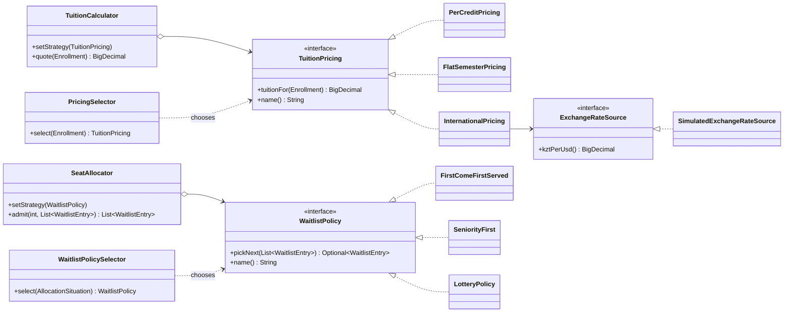

# Assignment 5 — Strategy Pattern: University Registration

Domain: university course registration. Two operations can be done in several interchangeable ways:

| Family | Interface | Strategies | Context | Selector |
|---|---|---|---|---|
| Tuition pricing | `TuitionPricing` | `PerCreditPricing`, `FlatSemesterPricing`, `InternationalPricing` | `TuitionCalculator` | `PricingSelector` |
| Waitlist seat allocation | `WaitlistPolicy` | `FirstComeFirstServed`, `SeniorityFirst`, `LotteryPolicy` | `SeatAllocator` | `WaitlistPolicySelector` |

`InternationalPricing` needs an external value (the KZT/USD exchange rate). It reads it through our own `ExchangeRateSource` interface: `SimulatedExchangeRateSource` in the demo, `FixedExchangeRate` (a fake with a constant rate) in tests.

## Build and run

Requires JDK 17+. Maven is bundled through the wrapper.

```bash
./mvnw test
./mvnw -q compile exec:java
./mvnw -q compile exec:java -Dexec.args="--all"
```

The second command opens the console menu; the third runs every demo section without input. On Windows use `mvnw.cmd`.

## Classes and responsibilities

| Class | Responsibility |
|---|---|
| `Student` | Holds identity, residency status plus earned credits of one student. |
| `Enrollment` | Pairs a student with the credit load requested for one semester. |
| `WaitlistEntry` | Records which student joined a course waitlist at what moment. |
| `RegistrationPhase` | Names the current stage of the registration calendar. |
| `ExchangeRateSource` | Hides where the current KZT-per-USD rate comes from. |
| `SimulatedExchangeRateSource` | Produces a randomly drifting KZT-per-USD rate near 500. |
| `TuitionPricing` | Declares how semester tuition gets computed for one enrollment. |
| `PerCreditPricing` | Charges a fixed tenge amount for every enrolled credit. |
| `FlatSemesterPricing` | Charges one fixed semester fee whatever the credit load. |
| `InternationalPricing` | Converts a per-credit USD price into tenge using the current exchange rate. |
| `PricingMode` | Maps each legacy pricing name to its strategy factory, keeping the pre-refactoring API working. |
| `TuitionCalculator` | Quotes tuition by delegating to the current pricing strategy. |
| `PricingSelector` | Picks the pricing strategy matching student residency plus credit load. |
| `AllocationSituation` | Describes the registration phase, free seats, waitlist length at one moment. |
| `WaitlistPolicy` | Declares how the next student gets picked from a waitlist. |
| `FirstComeFirstServed` | Picks the student who joined the waitlist earliest. |
| `SeniorityFirst` | Picks the student with the most earned credits; earlier joining breaks ties. |
| `LotteryPolicy` | Picks a uniformly random student using an injected random generator. |
| `SeatAllocator` | Fills free seats one by one, asking the current policy who goes next. |
| `WaitlistPolicySelector` | Picks the waitlist policy matching the registration phase plus current demand. |
| `StrategyDemo` | Shows every strategy on shared input, manual versus automatic choice, plus runtime switching. |
| `FixedExchangeRate` (test) | Returns one constant rate, keeping tests deterministic. |



## Selector rules

| Selector | Situation | Strategy |
|---|---|---|
| `PricingSelector` | international student | `InternationalPricing` |
| | local student, 12+ credits (full-time) | `FlatSemesterPricing` |
| | local student, under 12 credits | `PerCreditPricing` |
| `WaitlistPolicySelector` | `PRIORITY` phase | `SeniorityFirst` |
| | waitlist ≥ 3 × free seats (high demand) | `LotteryPolicy` |
| | otherwise | `FirstComeFirstServed` |

`if` statements appear only inside the two selectors. The contexts `TuitionCalculator` and `SeatAllocator` hold a strategy, accept a new one through `setStrategy()`, then delegate to it.

## Why Strategy, not State or Template Method

**Not State.** In State, the object switches its own behaviour when its internal state changes, and the state classes usually know about each other to trigger transitions (e.g. a registration moving from *pending* to *confirmed*). Here nothing inside `TuitionCalculator` or `SeatAllocator` changes the algorithm. The caller (a human through the menu, or a selector looking at the outside situation) picks the algorithm and passes it in. The strategies know nothing about each other, and none of them decides what runs next. The algorithm varies, the object's lifecycle does not.

**Not Template Method.** Template Method fixes the skeleton of an algorithm in an abstract base class and lets subclasses override some steps, so the variation is chosen at compile time through inheritance. Our strategies share no skeleton: per-credit multiplication, a constant fee, and a currency conversion through an external source are three unrelated computations, and the same is true for "earliest", "most senior" and "random". They are separate objects behind one interface, chosen through composition, and they can be swapped on a live context (`setStrategy()`), which inheritance cannot do.

**Why Strategy fits.** Each family is one task ("price an enrollment", "pick the next student") with several interchangeable algorithms. The algorithm is chosen at runtime, manually or by a selector, and a new one (for example a scholarship discount) is added as a new class without editing the context or the existing strategies (Open/Closed Principle).

## Refactoring history (tuition pricing)

| Step | Commit | Contents |
|---|---|---|
| Before | [`0376c80`](../../commit/0376c80c74d2accc9f313172cf1c5cc85da4f17b) | `TuitionCalculator` with all three pricing variants in one `switch (mode)` |
| After | [`2607751`](../../commit/2607751b55514676ac28cc892bbc30ae9611a0f6) | `TuitionPricing` interface, three strategy classes, `TuitionCalculator` only delegates |

`TuitionCalculatorTest` is identical on both commits (`git diff 0376c80 2607751 -- src/test` is empty), and all four of its tests pass on each. Both commits keep the entry point `TuitionCalculator.of(PricingMode, ExchangeRateSource)`, which is why `PricingMode` exists.

## Tests

`./mvnw test` runs 44 JUnit 5 tests:

- one test class per strategy (`PerCreditPricingTest`, `FlatSemesterPricingTest`, `InternationalPricingTest`, `FirstComeFirstServedTest`, `SeniorityFirstTest`, `LotteryPolicyTest`);
- every selector rule (`PricingSelectorTest`, `WaitlistPolicySelectorTest`);
- `@ParameterizedTest` over all strategies of a family: `PricingStrategiesContractTest` (tuition is never negative), `WaitlistPoliciesContractTest` (the picked student is always on the waitlist; an empty waitlist yields nobody);
- contexts (`TuitionCalculatorStrategyTest`, `SeatAllocatorTest`), the regression suite `TuitionCalculatorTest`, the simulated rate source, the domain checks.
